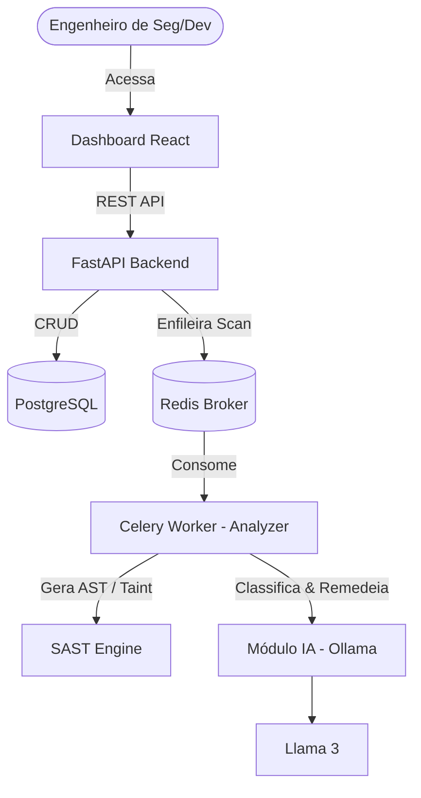

# Arquitetura da Plataforma SAST

## Visão Geral (C4 Model - Nível 1)
O sistema opera como uma plataforma de segurança orquestrada por filas, isolando a análise intensa de CPU (AST/Taint) e GPU (Ollama) da API pública.

## Componentes
1. **API (FastAPI):** Recebe webhooks do GitHub, gerencia estado do scan e persiste resultados.
2. **Analyzer (SAST Engine):** Faz o clone do repositório em disco efêmero; Python é a linguagem primária, com regras heurísticas e taint analysis limitadas. JavaScript/TypeScript e Java têm parsing experimental, não um conjunto equivalente de regras.
3. **AI Module:** Enriquecimento contextual. Lê o finding bruto e pode sugerir severidade, triagem e remediação. A triagem é armazenada como sugestão; não suprime automaticamente findings.
4. **DevSecOps (GitHub Actions):** O arquivo `devsecops.yml` cria um pipeline que consome Semgrep local e envia triggers para esta plataforma, bloqueando o Pull Request se a severidade for Critical.

## Segurança
- As rotas de scans, vulnerabilidades e estatísticas aceitam autenticação via header `X-API-Key` quando `SAST_API_KEY` está configurada; o health check permanece público para probes de disponibilidade. A ausência da chave é permitida apenas no desenvolvimento local.
- Os repositórios são clonados em um diretório temporário e removidos automaticamente ao término do scan.
