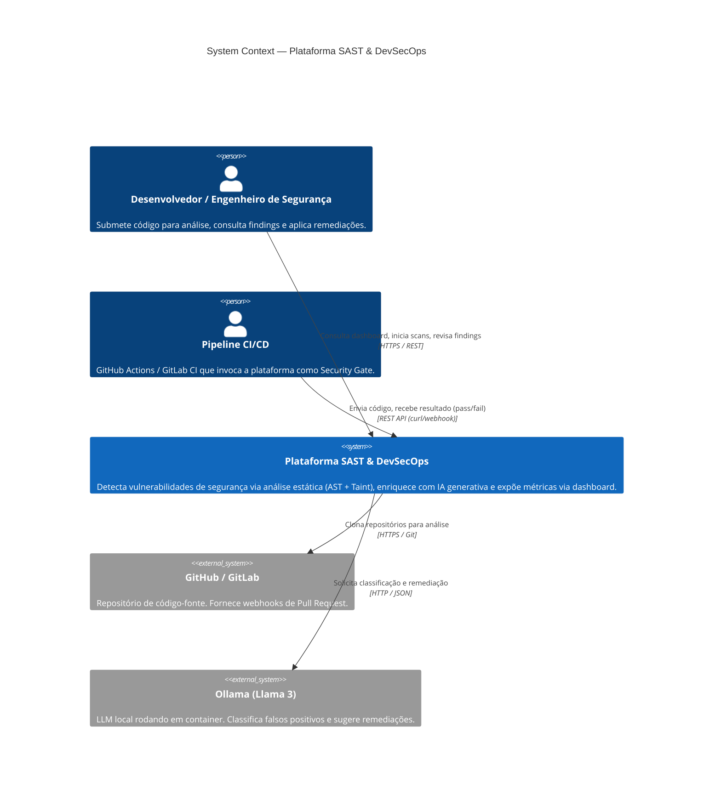
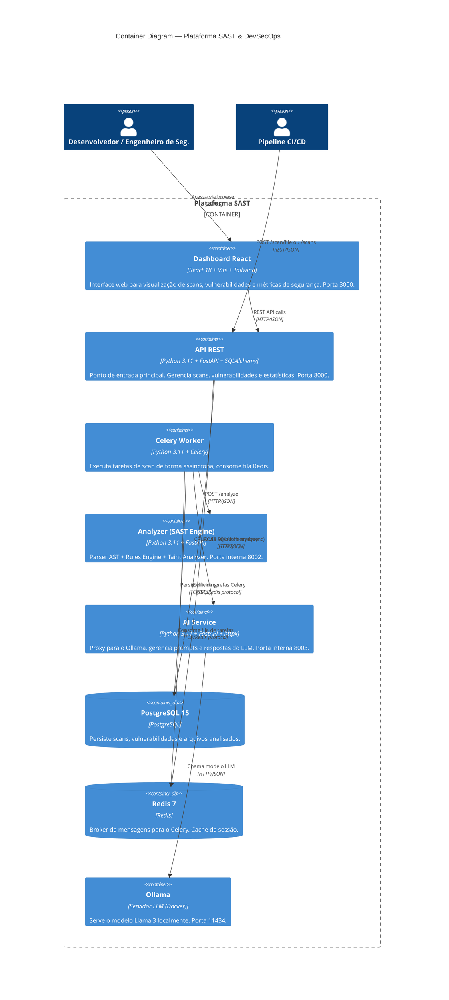
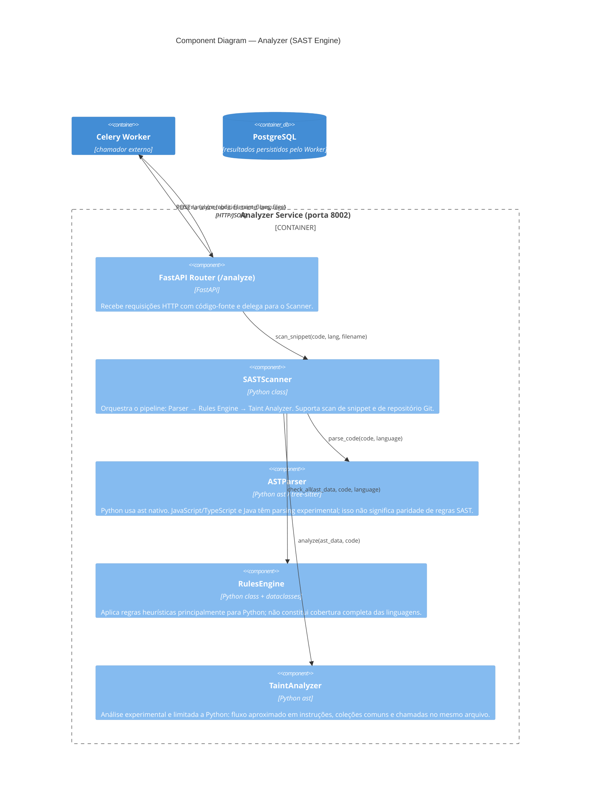
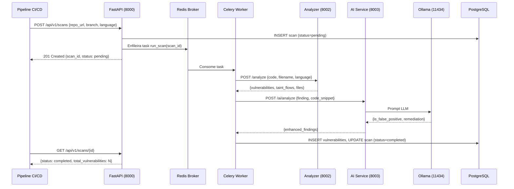

# Arquitetura da Plataforma SAST — C4 Model

Este documento descreve a arquitetura da Plataforma SAST & DevSecOps em três níveis do **C4 Model**: System Context, Container Diagram e Component Diagram.

---

## Nível 1 — System Context

> Quem usa o sistema e com quais sistemas externos ele se integra?

---

## Nível 2 — Container Diagram

> Quais são os principais executáveis / processos e como eles se comunicam?

---

## Nível 3 — Component Diagram: Serviço Analyzer

> Quais são os componentes internos do serviço de análise e como eles interagem?

---

## Fluxo de Dados de um Scan

